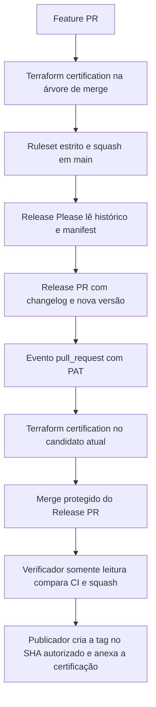

# Arquitetura

O CI lê o checkout do merge sintético e executa o exemplo e os contratos do módulo. A action de checkout descarta a credencial antes dos testes. O nome estável do job está vinculado à aplicação GitHub Actions no ruleset de main. A opção strict exige atualização após mudança da base. Cada run registra o SHA da cabeça, o SHA do merge de teste e a árvore. O squash muda a identidade do commit. Para auditar o conteúdo, compare a árvore da tag à árvore impressa no run.

O token efêmero do CI tem contents read. O job authorize usa token efêmero com leitura de Actions, conteúdo e PRs. O job release usa RELEASE_PLEASE_TOKEN no checkout, Git, gh e biblioteca Release Please. O token automático desse job tem permissions vazio. Actions pode criar PRs neste repositório. A CLI do mantenedor serve ao bootstrap, à governança e aos merges comuns. O ruleset exige PR, resolução de conversas, squash e CI, inclusive para o administrador. O único colaborador é CODEOWNER. Revisão independente obrigatória dependerá de outro mantenedor.

## Evolução para EKS e ECS

Substituir o passo Infrastructure certification extension por um job de certificação cuja conclusão o gate estável consuma como dependência obrigatória. Gerar uma matriz limitada por custo com plataforma, Kubernetes/Bottlerocket, região, arquitetura e addons. Criar recursos efêmeros identificados pelo SHA e run, verificar contratos com Terraform Test, runtime com Pytest, TaaC e Chainsaw quando aplicável, e testar upgrade a partir da release anterior. Executar destroy inclusive após falha e cancelamento, reconciliar resíduos por TTL com janitor independente e anexar inventário, logs e resultado de limpeza. Antes de liberar credenciais temporárias por OIDC, isolar a conta, o código confiável e o ambiente de aprovação.

Um coletor poderá consultar lançamentos oficiais de Bottlerocket, suporte padrão do EKS, imagens por arquitetura/região e APIs de addons. Deduplicar eventos por versão e plataforma, reconciliar por agendamento e abrir PRs com o diff das versões. Cada PR percorre a mesma certificação e governança.

A IA poderá analisar o diff entre tags, sugerir quebras, estimar impacto operacional e nos consumidores, propor testes e resumir evidências com links imutáveis. O resultado determinístico dos testes, o cálculo SemVer e a decisão dos revisores continuam como autoridades. Começar a extração para workflow_call pela certificação e coleta de evidências, depois descoberta upstream e reconciliação de release. Versionar os workflows reutilizáveis por SHA, com inputs explícitos para versões e outputs de evidência.
