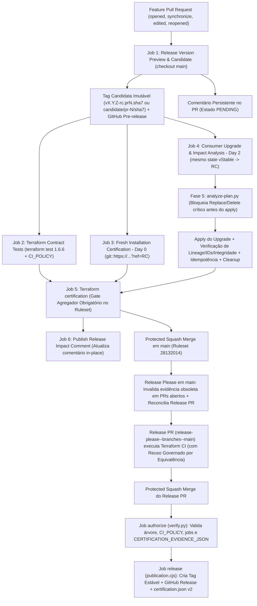

# Arquitetura

## 1. Fluxo End-to-End de Continuous Infrastructure Certification (Fase 2)

## 2. Modelo de Segurança e Isolamento de Privilégios

O CI separa estritamente a execução de código do PR das operações de escrita no GitHub:

1. **Ausência de PAT no CI de PR**: O secret `RELEASE_PLEASE_TOKEN` **nunca** é referenciado em `.github/workflows/ci.yml`. Ele permanece restrito ao job `release` de `.github/workflows/release-please.yml` em `refs/heads/main`.
2. **Jobs privilegiados no CI (`prepare-candidate` e `publish-comment`)**:
   - Fazem checkout explícito de `refs/heads/main` (código confiável já homologado).
   - O job `prepare-candidate` busca os commits do PR apenas como objetos Git (`git fetch`), calcula a previsão com `scripts/release/preview.cjs`, cria a referência candidata imutável com `scripts/release/rc.cjs` e publica o comentário inicial via `GITHUB_TOKEN` efêmero com permissões restritas ao job (`contents: write`, `pull-requests: write`).
   - O job `publish-comment` (`permissions: contents: read, pull-requests: write`) consome apenas o relatório JSON estruturado e sanitizado do gate agregador para atualizar o comentário persistente.
3. **Jobs de teste (`contract-tests`, `fresh-installation`, `consumer-upgrade`, `Terraform certification`)**:
   - Executam com `permissions: contents: read` e `persist-credentials: false` no `actions/checkout`.
   - Consomem a referência candidata real a partir do GitHub (`git::https://github.com/TomasAlric/terraform-module-release-please-poc.git?ref=<CANDIDATE_REF>`) em diretórios temporários isolados fora do checkout do repositório.
4. **Verificação pré-publicação (`authorize` / `scripts/release/verify.py`)**:
   - Opera em modo somente leitura com `GITHUB_TOKEN`.
   - Valida a proteção do ruleset de `main`, os hashes Git (`CI_POLICY`) de `.github/workflows/ci.yml`, `scripts/certify.sh` e `scripts/certify/*`, a conclusão `success` de todos os 5 jobs obrigatórios antes do merge, a igualdade entre a árvore testada e a árvore do squash commit, e o registro `CERTIFICATION_EVIDENCE_JSON` assinado no log do job `Terraform certification`.

## 3. Documentação detalhada da Fase 2

- [Previsão de Versão e Comentário Automático](release-version-preview.md)
- [Gerenciamento de Release Candidates (Alternativa A vs B)](release-candidate-management.md)
- [Certificação Day 0 (Fresh Install), Day 2 (Consumer Upgrade) e Upgrade Impact Analysis](consumer-upgrade-certification.md)
- [Procedimento de Operação e Governança](release-management.md)
- [Relatório de Homologação Fase 1 (H01–H17)](validation-report.md)
- [Relatório de Homologação Fase 2 (H18–H34)](validation-report-phase-2.md)

## 4. Preparação para Evolução Corporativa (Amazon EKS e Amazon ECS)

A arquitetura homologada nesta POC foi desenhada como motor de orquestração e governança para substituição direta dos recursos fictícios (`terraform_data`) pelos módulos corporativos de infraestrutura de containers.

### 4.1 Evolução para Amazon EKS

No módulo corporativo de EKS, `scripts/certify/run-day0.sh`, `scripts/certify/run-day2.sh` e `scripts/certify/analyze-plan.py` são conectados aos seguintes componentes reais:

- **Provisionamento efêmero (Managed Node Groups e Karpenter)**:
  - Day 0 provisiona clusters EKS efêmeros identificados por `pr-<N>-<sha7>-<run_id>` com Managed Node Groups e provisioners/NodePools do Karpenter.
  - Day 2 provisiona a última release estável do módulo EKS e aplica o upgrade in-place para a Release Candidate sobre o **mesmo Terraform state** (em backend S3/DynamoDB efêmero isolado por execução).
- **Matrizes de versões Kubernetes, Bottlerocket e Arquiteturas**:
  - Execução parametrizada cobrindo versões do EKS em suporte padrão (`1.30`, `1.31`, `1.32`), versões de AMI Bottlerocket (`aws-k8s-*`) e arquiteturas `x86_64` (`amd64`) e `arm64` (Graviton).
- **Add-ons e Contratos**:
  - Validação de add-ons críticos (`coredns`, `kube-proxy`, `vpc-cni`, `aws-ebs-csi-driver`, `metrics-server`, Karpenter) com **Terraform Test** (contratos HCL/plan) e **TaaC com Pytest** / **Chainsaw** (testes declarativos de recursos Kubernetes e operadores).
- **Workloads reais, Scale-out/Scale-in, Disponibilidade e Persistência**:
  - Deploy de workloads de teste com `PodDisruptionBudget`, Horizontal Pod Autoscaler e `PersistentVolumeClaim` (EBS CSI).
  - Durante o Consumer Upgrade (Day 2), o marcador de integridade de dados (`data_integrity_marker` na POC) é substituído por um workload real com volume EBS persistente e sondas contínuas de disponibilidade HTTP/gRPC, comprovando zero perda de dados no volume e preservação do SLO durante o rolling upgrade / upgrade de nodes Bottlerocket.
  - `analyze-plan.py` passa a bloquear qualquer `replace` ou `delete` em `aws_eks_cluster`, `aws_kms_key`, `aws_iam_role` de control plane, `aws_VPC` ou `PersistentVolume` antes do `terraform apply`.
- **Destroy automático, Janitor e Inventário Residual**:
  - O bloco `trap cleanup EXIT` executa remoção ordenada de workloads/load balancers seguida de `terraform destroy` com retry exponencial (`destroy-retry`).
  - Um job **Janitor** independente (agendado via cron na conta AWS de testes) varre recursos com tag `ephemeral:ttl_expired = true` e anexa o inventário residual antes/depois à evidência da execução.

### 4.2 Evolução para Amazon ECS

No módulo corporativo de ECS:

- **EC2, Fargate e Capacity Providers**:
  - Day 0 e Day 2 certificam clusters ECS com Capacity Providers Fargate (`FARGATE`, `FARGATE_SPOT`) e Auto Scaling Groups EC2 com Bottlerocket (`aws-ecs-2`) em `x86_64` e `arm64`.
- **Instance Refresh, Tasks reais, Drain e Upgrade**:
  - Day 2 provisiona serviços ECS reais na versão estável do módulo, aplica a Release Candidate no mesmo state, valida a política de Terraform Plan (`analyze-plan.py` bloqueando recriação de `aws_ecs_cluster`, `aws_lb` ou `aws_ecs_service` stateful) e acompanha o **Instance Refresh**, o **container instance draining** e a saúde das tasks durante o upgrade.
- **Destroy e Janitor**:
  - Drenagem automática de tasks, `terraform destroy` com `destroy-retry` e reconciliação de recursos órfãos pelo Janitor.

### 4.3 Pontos de Extensão Preparados para Capacidades Futuras

A arquitetura da Fase 2 já define contratos JSON e pontos de acoplamento determinísticos para:

1. **Bottlerocket Version Watcher & Renovação Automatizada de Dependências**:
   - Workflow agendado que consulta novas releases do Bottlerocket/EKS e abre PRs convencionais (`feat:` ou `fix:`). Cada PR aberto aciona automaticamente `ci.yml`, gerando Release Preview, RC, testes Day 0 e upgrade Day 2 a partir da release estável vigente.
2. **Dynamic Test Matrix**:
   - O job `prepare-candidate` já analisa os arquivos alterados (`git diff --name-only`) e metadados do PR em `preview.json`, permitindo emitir como output do job uma matriz dinâmica JSON (`fromJson(needs.prepare-candidate.outputs.test_matrix)`) para selecionar apenas as combinações relevantes de EKS/ECS, arquitetura e versão.
3. **AI Risk Assessment & AI Release Notes**:
   - `analyze-plan.py` já exporta o objeto `ai_risk_assessment_extension` (`hook_point: "post_plan_deterministic_gate"`, `deterministic_authority: true`). Um agente de IA poderá enriquecer o comentário do PR e as notas da release com análise semântica do diff e resumo de riscos operacionais, mantendo o bloqueio determinístico de `analyze-plan.py` e `aggregate-gate.py` como autoridade final.
4. **Power Automate & Notificações no Microsoft Teams após Homologação**:
   - O payload estruturado de `gate-report.json` (no PR) e `certification.json` (na publicação estável em `release-please.yml`) possui schema JSON estável pronto para envio por webhook ao Power Automate / Microsoft Teams com status Day 0, Day 2, impacto de plano e links das evidências.
5. **Chainsaw, P4ALL e Reusable Workflows (`workflow_call`)**:
   - Os scripts modulares em `scripts/certify/` e `scripts/release/` são desacoplados do repositório via variáveis de ambiente e argumentos de CLI, permitindo extração imediata para Reusable Workflows (`.github/workflows/reusable-certification.yml`) versionados por SHA imutável e invocados por múltiplos repositórios de módulos Terraform.
