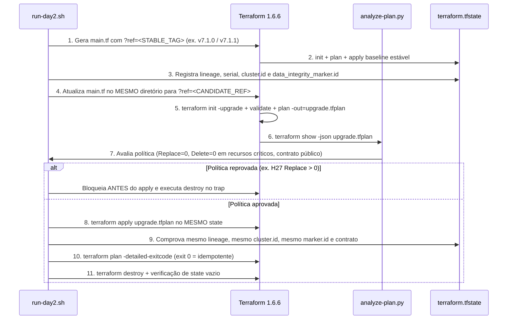

# Consumer Upgrade & Fresh Installation Certification (Fases 3, 4 e 5)

## 1. Princípio central

> **Uma release estável não deve ser publicada antes de comprovarmos que o módulo funciona tanto para novos consumidores (Day 0) quanto para consumidores que já possuem infraestrutura provisionada (Day 2).**

Como demonstrado experimentalmente no experimento **H27** (PR #26, commit `d299f87`), uma alteração que introduz `triggers_replace` no recurso principal do módulo passa em 100% dos testes de contrato (`terraform test`) e em 100% dos testes de Fresh Installation (Day 0), pois uma instalação limpa não possui estado anterior para substituir. Somente a certificação de **Consumer Upgrade (Day 2)** combinada com a **Upgrade Impact Analysis (Fase 5)** detectou e bloqueou a substituição destrutiva antes do `terraform apply`.

## 2. Fase 3 — Fresh Installation Certification (Day 0)

Implementada em `scripts/certify/run-day0.sh`, executada em diretório temporário externo ao checkout do repositório (`mktemp -d`) para garantir ausência total de dependência de arquivos locais não publicados.

### Cenários validados

1. `fresh_defaults`: Consumo remoto usando apenas o parâmetro obrigatório `cluster_name = "consumer-day0-defaults"` e todos os valores default do módulo.
2. `fresh_custom`: Consumo remoto com inputs customizados (`cluster_version = "1.32"`, `bottlerocket_version = "1.25.0+build.1"`, alias OCI `architecture = "amd64"`, `capacity_model = "SPOT"`, múltiplos `addons`, `addon_channels`, `addon_owners` e `tags`).

### Configuração consumidora gerada dinamicamente

```hcl
module "cluster" {
  source = "git::https://github.com/TomasAlric/terraform-module-release-please-poc.git?ref=v7.1.1-rc.pr26.b46ee01"

  cluster_name = "consumer-day0-defaults"
}
```

### Ciclo de 10 etapas verificadas por cenário

1. `terraform init -input=false`
2. **Comprovação criptográfica da origem remota**:
   - Inspeciona `.terraform/modules/modules.json` confirmando que `Source` contém `?ref=<CANDIDATE_REF>`.
   - Calcula o hash SHA-256 dos arquivos `.tf` baixados em `.terraform/modules/cluster` e compara com o hash da árvore certificada.
3. `terraform validate`
4. `terraform plan -out=day0.tfplan`
5. `terraform apply day0.tfplan`
6. Verificação de contratos públicos via `terraform output -json` (incluindo resolução canônica de `amd64` -> `x86_64`).
7. Verificação do recurso `module.cluster.terraform_data.cluster` no estado (`terraform show -json`).
8. **Idempotência**: `terraform plan -detailed-exitcode` (exige código de retorno `0`).
9. `terraform destroy -auto-approve`
10. **Verificação de limpeza**: Confirma `.resources | length == 0` no `terraform.tfstate` e remove os diretórios temporários via `trap EXIT`.

## 3. Fase 4 — Consumer Upgrade Certification (Day 2)

Implementada em `scripts/certify/run-day2.sh`. Simula fielmente a jornada de upgrade in-place de um consumidor real.



### Garantias de continuidade de estado

Para cada cenário, o script registra antes e depois do upgrade (emitindo apenas digests SHA-256 e booleanos sanitizados nas evidências):

- **`state_lineage`**: Comprova que exatamente o mesmo arquivo `terraform.tfstate` foi utilizado (`post_lineage == base_lineage`) e que o `serial` avançou (`post_serial > base_serial`).
- **`module.cluster.terraform_data.cluster.id`**: Comprova que o recurso principal do cluster sofreu atualização in-place ou no-op, mantendo exatamente o mesmo UUID (`post_cluster_id == base_cluster_id`), sem recriação.
- **`terraform_data.data_integrity_marker`**: Recurso persistente acoplado ao cluster que valida preservação de integridade de dados (`marker_token` e `id` inalterados).

### Cinco cenários representativos de consumidores

| Cenário | Versão inicial | Comportamento validado durante o upgrade para a RC | Impacto esperado no Plan |
|---|---|---|---|
| `defaults` | Última estável (`v7.1.0` / `v7.1.1`) | Consumidor utilizando apenas `cluster_name` e defaults do módulo. | `create: 0, update: 0/1, replace: 0, delete: 0` |
| `custom` | Última estável | Consumidor com `cluster_version = "1.32"`, `bottlerocket_version = "1.25.0"`, `architecture = "arm64"`, `capacity_model = "SPOT"`. | `create: 0, update: 0/1, replace: 0, delete: 0` |
| `optional_features` | Última estável | Consumidor utilizando alias OCI `amd64`, `addons`, `addon_channels`, `addon_owners` e adição de tag opcional `upgraded = "true"`. | `create: 0, update: 1, replace: 0, delete: 0` |
| `contract_evolution` | Última estável | Consumidor realizando upgrade simultâneo do módulo e de versão Kubernetes (`1.31` -> `1.32`) / Bottlerocket (`1.24.0` -> `1.25.0`) + novo recurso de auditoria. | `create: 1, update: 1, replace: 0, delete: 0` |
| `breaking_migration` | `v6.3.0` (pré-breaking change) | Consumidor real migrando da `v6.3.0` (`capacity_type = "SPOT"`) para a RC (`capacity_model = "SPOT"`) no **mesmo Terraform state**, comprovando migração de breaking change sem destruir o cluster. | `create: 0, update: 1, replace: 0, delete: 0` |

## 4. Fase 5 — Upgrade Impact Analysis (`scripts/certify/analyze-plan.py`)

O analisador determinístico inspeciona o JSON produzido por `terraform show -json upgrade.tfplan` **antes** do `terraform apply`:

1. **Classificação de ações**:
   - `["no-op"]` / `["read"]` -> `no_op`
   - `["create"]` -> `create`
   - `["update"]` -> `update`
   - `["delete"]` -> `delete`
   - `["delete", "create"]` ou `["create", "delete"]` -> `replace`
2. **Política de preservação de recursos críticos**:
   - Recursos críticos protegidos: `module.cluster.terraform_data.cluster` e `terraform_data.data_integrity_marker`.
   - Qualquer ação `replace` ou `delete` sobre um recurso crítico reprova imediatamente `critical_resource_preservation = "FAIL"` e `upgrade_authorization = "FAIL"`, abortando a execução antes do `apply`.
   - **Governança de MAJOR**: A simples classificação SemVer `MAJOR` no PR **não autoriza automaticamente** destruição ou substituição (`replace`/`delete`) de recursos críticos.
3. **Política de compatibilidade de contratos públicos**:
   - Verifica em `planned_values.outputs.cluster` a presença de todas as chaves obrigatórias do contrato (`name`, `version`, `bottlerocket_version`, `architecture`, `capacity_type`, `addons`, `addon_channels`, `addon_owners`, `tags`), a imutabilidade de `cluster.name` e a exigência de documentação de migração quando `declared_breaking == true`.
4. **Ponto de extensão para IA**:
   - O JSON emitido inclui o bloco estruturado `ai_risk_assessment_extension` (`hook_point: "post_plan_deterministic_gate"`, `deterministic_authority: true`), permitindo acoplar avaliação futura por IA sem substituir a autoridade determinística do gate.

## 5. Limpeza garantida e limites operacionais

- Tanto `run-day0.sh` quanto `run-day2.sh` registram `trap cleanup EXIT`, garantindo `terraform destroy -auto-approve` e verificação de `.resources | length == 0` mesmo quando um teste ou política falha (comprovado nos runs `45943905381` [H27] e `45944200181` [H26], onde o upgrade foi bloqueado e o cleanup executou com `PASS`).
- Nenhum arquivo `terraform.tfstate` bruto ou plano binário/JSON bruto é publicado em comentários ou logs; apenas contagens de ações e digests SHA-256 dos identificadores são exportados.
- **Limites em caso de perda abrupta do runner**: Para o módulo fictício baseado em `terraform_data`, o estado reside em diretório temporário do runner efêmero do GitHub Actions e é descartado com a VM. Na evolução corporativa para AWS (EKS/ECS), uma queda abrupta do runner (`SIGKILL` ou falha de host) impediria a execução do `trap EXIT` local; por isso a arquitetura corporativa exige tags de TTL nos recursos AWS e um processo **Janitor / destroy-retry** independente agendado na conta de homologação.
