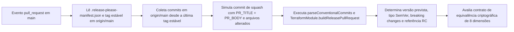

# Release Version Preview (Fase 1)

## 1. Objetivo

Permitir que autores, revisores e automações conheçam de forma determinística, antes da aprovação e do merge de qualquer Pull Request destinado à `main`:

1. A última versão estável publicada do módulo Terraform (`current_stable_tag`).
2. A próxima versão prevista (`expected_next_tag`) caso o PR seja integrado via squash merge.
3. O tipo de incremento SemVer (`PATCH`, `MINOR`, `MAJOR` ou `NONE`).
4. A existência de breaking changes declaradas no PR ou acumuladas na `main`, diferenciando-as de incompatibilidades técnicas detectadas nos testes de contrato e upgrade.

## 2. Motor de cálculo e alinhamento com o Release Please

Para evitar divergências entre a previsão no Pull Request e a versão efetivamente calculada na publicação, o script `scripts/release/preview.cjs` utiliza diretamente a biblioteca oficial fixada `release-please@17.6.0`:

- `TerraformModule` (`release-please/build/src/strategies/terraform-module`)
- `parseConventionalCommits` (`release-please/build/src/commit`)
- `TagName` (`release-please/build/src/util/tag-name`)
- `Version` (`release-please/build/src/version`)

### Fluxo de cálculo determinístico



1. **Descoberta dinâmica da baseline estável**:
   - Lê `.release-please-manifest.json` de `origin/main` (por exemplo, `7.1.0` -> `v7.1.0`, e após promoção `7.1.1` -> `v7.1.1` e `7.2.0` -> `v7.2.0`).
   - Resolve o SHA exato do commit apontado pela tag estável (`refs/tags/v<versão>^{commit}`).
2. **Coleta de alterações acumuladas na `main`**:
   - Coleta todos os commits já integrados em `origin/main` após o SHA da última tag estável (`git log <stable_tag_sha>..origin/main`).
3. **Simulação fiel do squash merge**:
   - O repositório está configurado com `squash_merge_commit_title = PR_TITLE` e `squash_merge_commit_message = PR_BODY`.
   - Para Feature PRs (`head_ref != release-please--branches--main`), `preview.cjs` constrói o commit sintético de squash contendo exatamente `<PR_TITLE>\n\n<PR_BODY>` e a lista de arquivos alterados no PR (`git diff --name-only <base_sha>...<head_sha>`).
   - Para o próprio Release PR (`head_ref == release-please--branches--main`), avalia os commits acumulados na `main` e valida a consistência com o `.release-please-manifest.json` proposto na branch do bot.
4. **Classificação SemVer e detecção de mudanças sem release**:
   - Quando `strategy.buildReleasePullRequest(...)` retorna `undefined` (ex.: PRs `docs:`, `ci:`, `chore:`, `test:`, `refactor:` sem `BREAKING CHANGE` e sem commits elegíveis acumulados na `main`), a previsão reporta explicitamente:
     - `Expected next version: None (no release triggered — remains vX.Y.Z)`
     - `Release type: NONE`

## 3. Eventos suportados

O workflow `.github/workflows/ci.yml` executa nos eventos:

- `opened`
- `reopened`
- `synchronize`
- `edited` (atualiza imediatamente a previsão quando título ou corpo do PR mudam, como validado entre H20 `feat!:` -> `v8.0.0` e H19 `feat:` -> `v7.2.0` no PR #27)
- `ready_for_review`

Adicionalmente, quando a branch `main` avança (`push` em `main`), o workflow `.github/workflows/release-please.yml` executa `node scripts/release/comment.cjs invalidate-stale`, atualizando automaticamente os comentários de PRs abertos cuja `Base SHA` ficou obsoleta (validado em H33).

## 4. Comentário persistente e separação de privilégios

O gerenciamento do comentário no PR é realizado por `scripts/release/comment.cjs` utilizando o marcador HTML estável:

```html
<!-- release-impact-certification-marker:v2 -->
```

### Garantias de segurança e idempotência

- **Atualização in-place sem duplicidade**: O script busca comentários existentes contendo o marcador e executa `PATCH /repos/{owner}/{repo}/issues/comments/{comment_id}`. Caso mais de um comentário com o marcador existisse, duplicatas seriam removidas.
- **Estados pendentes e finais**:
  - No início da pipeline (`prepare-candidate`), o comentário é publicado/atualizado com todos os checks em estado `PENDING`.
  - Ao término da pipeline (`publish-comment`, executado com `if: always()`), o mesmo comentário é atualizado com a tabela final (`PASS`/`FAIL`), o resumo sanitizado de `Upgrade Impact`, links imutáveis para a referência candidata e para o workflow run, e diagnósticos de falha.
- **Separação entre execução de código do PR e escrita do comentário**:
  - Os jobs que executam Terraform e código da branch do PR (`contract-tests`, `fresh-installation`, `consumer-upgrade`, `Terraform certification`) possuem exclusivamente `permissions: contents: read`, `persist-credentials: false` e **nenhum acesso** ao `RELEASE_PLEASE_TOKEN` ou permissão de escrita em PRs.
  - O job `publish-comment` faz checkout explícito de `refs/heads/main`, consome apenas o JSON estruturado do gate agregador e aplica sanitização contra vazamento de tokens ou estado bruto antes de atualizar o comentário.
